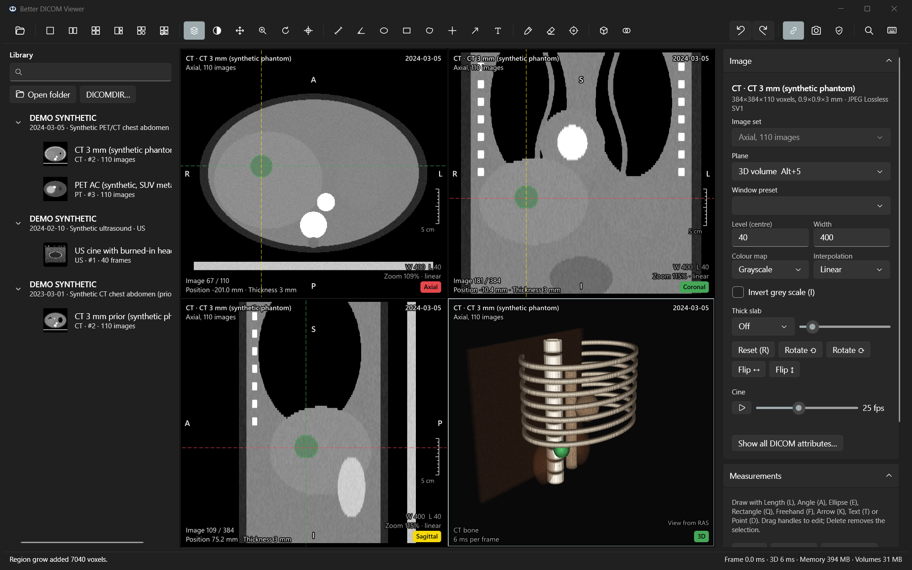
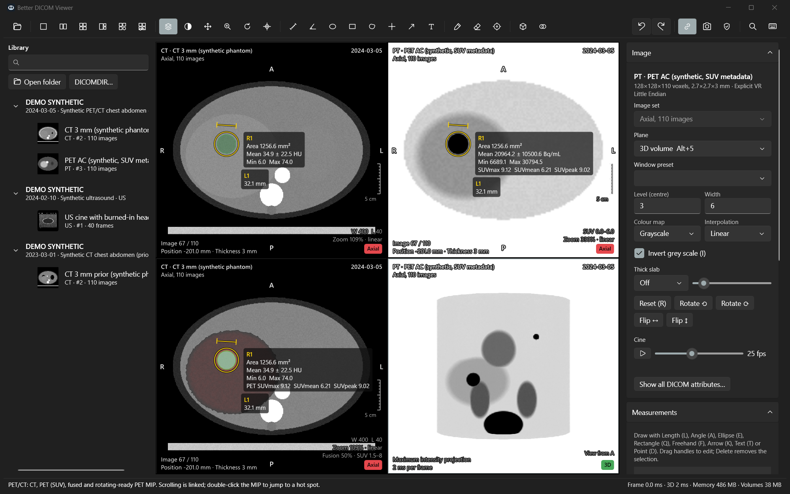
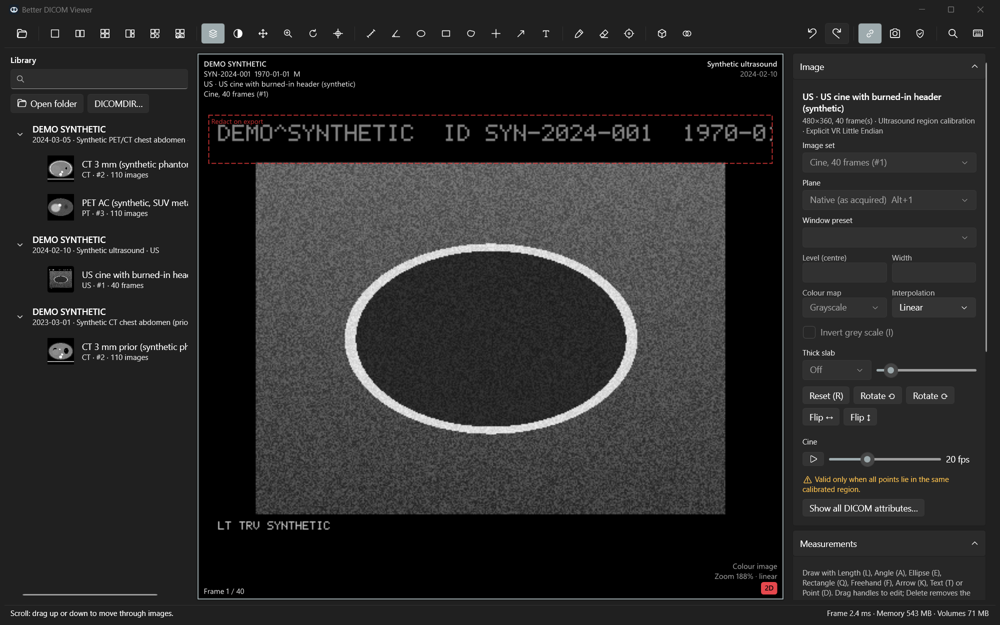

# Better DICOM Viewer

A native Windows 11 DICOM viewer with a dark-only interface, built for fast interaction. It reads scans in place from a folder or a copied CD/DVD, shows 2D, MPR and 3D views, fuses PET with CT, measures in physical units, segments structures, and writes de-identified copies.



> Not for clinical diagnosis. The software has not been validated as a medical device.

## Status

Version 0.1 is a working application: CT and PET volumes, radiographs, ultrasound stills and cine, MPR and oblique reformats, GPU volume rendering, measurements, PET/CT fusion with SUV, segmentation, screenshots, measurement export and de-identified export all run on real and synthetic data. [docs/capabilities.md](docs/capabilities.md) lists what is validated, what is only manually tested, and what is still missing.

## Install and run

Requirements: Windows 10 1809 or later (Windows 11 recommended), 64-bit, 8 GB RAM or more. A GPU with OpenGL 3.2 is needed only for 3D rendering.

1. Build the package (see below) or take a release zip, then extract `BetterDicomViewer-0.1.0-win-x64.zip` to any folder.
2. Run `BetterDicomViewer.exe`. Nothing is installed and no administrator rights are needed.
3. Open scans with **Open folder** (Ctrl+O), **DICOMDIR…** (Ctrl+Shift+O), or by dragging a folder onto the window. To try the app without real scans, click **Open synthetic demo study**.

The package is self-contained: it includes the .NET runtime, the VTK imaging bridge (`bdv_vtk.dll`) and the DICOM codecs. The app never contacts the network.

On laptops with two GPUs, the app sets the Windows per-app graphics preference to the high-performance GPU on first start, unless you have already chosen one. 3D rendering on the test laptop dropped from 169 ms to 10 ms per frame with that change. The 3D panel shows the active GPU and has a checkbox to switch, and **Settings › System › Display › Graphics** shows the same setting.

## Build from source

Prerequisites: .NET 10 SDK, Visual Studio 2022 Build Tools with the C++ workload (or another MSVC toolset), CMake 3.20+, Ninja and Git.

```powershell
# One time: build VTK 9.7.1 (static, about 20 minutes with 20 threads) into .deps\ or %BDV_DEPS_DIR%
powershell -File scripts\build-vtk.ps1

# Build the native bridge (artifacts\native\bdv_vtk.dll)
powershell -File scripts\build-native.ps1

# Build, test and run
dotnet test tests\BetterDicomViewer.Tests
dotnet run --project src\BetterDicomViewer.App

# Self-contained release folder and zip under artifacts\
powershell -File scripts\package.ps1
```

The scripts find MSVC through `vswhere`. Machine-specific locations (a portable MSVC, a different `dotnet.exe` or dependency folder) go in the gitignored `scripts\local.env.ps1` as `BDV_MSVC_SETUP`, `BDV_DOTNET`, `BDV_DEPS_DIR` and `BDV_NINJA_DIR`.

## Using the app

**Open scans.** The library lists patients, studies and series, with thumbnails and a search box (Ctrl+F) that matches names, IDs, dates, descriptions and modalities. When a DICOMDIR exists, studies appear immediately and headers are read in the background. Without one, folders are scanned recursively and files are recognised by content, so extensionless files work. Non-image objects (presentation states, reports) and unsupported transfer syntaxes are listed with the reason instead of being skipped silently. Double-click a series or drag it onto a viewport.

**View.** Scroll with the wheel or arrow keys, window/level with a right-drag, pan with a middle-drag, and zoom with Ctrl+wheel. Number keys 1–9 apply window presets (HU presets for CT, SUV ranges for PET). Orientation labels, a scale bar and slice position are shown on the image. Series with several image sets (for example a localizer, or native slices next to a resampled volume) have an **Image set** selector in the inspector.

**MPR, oblique and 3D.** Ctrl+4 shows axial, coronal and sagittal views linked by colour-coded reference lines. With the crosshair tool (C), drag to move every view to a point, or drag the round handle on a line to tilt that plane into an oblique reformat. Shift+M cycles thick-slab mean, MIP and MinIP. Alt+5 (or Ctrl+5 for MPR plus 3D) shows GPU volume rendering with presets, MIP, MinIP, average projection, opacity controls, cropping and segment surfaces. Double-click a structure in 3D to move the 2D views there.

**Measure.** Length (L), angle (A), ellipse (E), rectangle (Q), freehand (F), point value (D), arrow (K) and text (T). ROIs report area, mean, SD, min and max in modality units, and SUVmax, SUVmean and SUVpeak for PET. An ROI drawn on a fused CT also reports the PET statistics. Measurements use patient millimetres for volumes. Projection radiographs use Pixel Spacing or Imager Pixel Spacing (with the magnification caveat stated), and ultrasound uses the calibrated region the points lie in. Uncalibrated images measure in pixels and say so. Drag handles to edit, Delete to remove, Ctrl+Z / Ctrl+Y to undo and redo. Measurements are saved per study in local app data and export to CSV or JSON ([format](docs/measurement-export.md)).

**PET/CT.** Ctrl+6 picks the attenuation-corrected PET and the matching CT and shows CT, PET in SUV, the fusion, and a 3D PET MIP. Opacity, colour map and range are in the **PET/CT fusion** panel, and Shift+Up/Down changes opacity. SUV is calculated only when units, decay correction, injected dose, half-life, injection and scan times and patient weight are all present and plausible. The scan reference time is checked against the scanner's Decay Factor. If anything is missing, values stay in Bq/mL and the panel lists the reason.



**Compare.** Ctrl+2 shows two viewports side by side, for example a prior and a current study. Scrolling is linked (Ctrl+L): views in the same frame of reference follow the same patient position. Studies from different frames start at the same patient position when their slice ranges overlap. To align them by hand, turn linking off, scroll one, then turn it on again.

**Segment.** Brush (B), eraser (X; Shift+drag with the brush also erases) and region grow (G) edit the active segment. Options in the **Segmentation** panel restrict painting to an intensity range, switch to a 3D sphere brush, or grow in 2D or 3D. **Fill range in volume** applies a threshold. **Fill between slices** interpolates shapes across skipped slices. Segments save automatically to local app data. They export as NRRD (LPS) or NIfTI (RAS) label maps, STL or OBJ surfaces in patient millimetres, or a CSV of volume and intensity statistics.

**Export.** Ctrl+Shift+S saves a screenshot of the active viewport or all viewports, with patient details hidden by default. Ctrl+C copies the viewport image. Ctrl+Shift+D writes a de-identified copy (see [docs/deidentification.md](docs/deidentification.md)): new files in an empty folder outside the scan folders, a DICOMDIR, and a report. Images that may carry burned-in text are excluded by default, or can be redacted with rectangles drawn using **Draw redaction region**.



## Keyboard and mouse shortcuts

F1 (or Shift+?) opens this list in the app, with search. Ctrl+K opens a command palette that lists every command. The tables below are generated from the same command registry the app uses.

| Keys | Action |
| --- | --- |
| `Ctrl+O` | Open folder |
| `Ctrl+Shift+O` | Open DICOMDIR file |
| `Ctrl+F` | Search the library |
| `Ctrl+Shift+S` | Save screenshot |
| `Ctrl+C` | Copy viewport image |
| `Ctrl+Shift+M` | Export measurements |
| `Ctrl+Shift+E` | Export segmentation |
| `Ctrl+Shift+D` | Export de-identified copy |
| `Ctrl+1` … `Ctrl+6` | Layouts: single, side by side, 2 × 2, MPR, MPR + 3D, PET/CT |
| `Alt+1` … `Alt+5` | Plane: native, axial, coronal, sagittal, 3D |
| `M` | Maximize or restore the active viewport (also double-click) |
| `Ctrl+Tab` | Next viewport |
| `Ctrl+B`, `Ctrl+I` | Show or hide the library, the inspector |
| `F11` | Full screen |
| `Ctrl+Shift+H` | Hide or show patient details on screen |
| `Ctrl+R` | Show or hide reference lines |
| `Ctrl+L` | Link scrolling between viewports |
| `Down`, `Up` | Next, previous image |
| `Page Down`, `Page Up` | Forward, back 10 images |
| `Home`, `End` | First, last image |
| `Right`, `Left` | Next, previous image set or series |
| `Space` | Play or pause cine |
| `1` … `9` | Window presets (listed in the Image panel) |
| `R` | Reset view and window |
| `0` | Fit image to viewport |
| `+`, `-` | Zoom in, out |
| `I` | Invert grey scale |
| `H`, `V` | Flip horizontally, vertically |
| `[`, `]` | Rotate 90° left, right |
| `N` | Cycle interpolation (nearest, linear, cubic) |
| `Shift+M` | Cycle thick slab (off, mean, MIP, MinIP) |
| `Shift+[`, `Shift+]` | Thinner, thicker slab |
| `Shift+F` | Show or hide PET fusion |
| `Shift+Up`, `Shift+Down` | More, less PET fusion opacity |
| `S`, `W`, `P`, `Z`, `O` | Tools: scroll, window/level, pan, zoom, rotate |
| `C` | Crosshair and oblique planes |
| `L`, `A`, `E`, `Q`, `F` | Length, angle, ellipse, rectangle and freehand ROI |
| `D`, `K`, `T` | Point value, arrow, text |
| `B`, `X`, `G` | Segmentation brush, eraser, region grow |
| `Ctrl+Shift+N` | New segment |
| `Ctrl+[`, `Ctrl+]` | Smaller, larger brush |
| `Ctrl+Z`, `Ctrl+Y` (or `Ctrl+Shift+Z`) | Undo, redo |
| `Delete` | Delete the selected measurement |
| `Esc` | Cancel drawing, clear selection, leave full screen |
| `F1`, `Shift+?` | Shortcut reference |
| `Ctrl+K`, `Ctrl+Shift+P` | Command palette |

| Mouse | Action |
| --- | --- |
| Left drag | Active tool |
| Right drag | Window / level (any tool) |
| Middle drag, Ctrl + left drag | Pan |
| Ctrl + right drag, Shift + left drag, Ctrl + wheel | Zoom |
| Wheel, Shift + wheel | Next or previous image, 5 images at a time (with the brush: brush size) |
| Double-click | Maximize or restore the viewport; in 3D, move linked views to the point |
| 3D: left drag, Ctrl + left drag, right drag, middle drag | Rotate, roll, zoom, pan |
| Crosshair: drag, drag a line handle | Move all views to a point; tilt that plane |
| Drag a measurement handle or line | Edit or move it |

## Data handling and privacy

- Source scans are opened read-only and never modified, copied or moved. The de-identified export refuses to write inside a source folder.
- The local header index, saved measurements and segmentations live under `%LOCALAPPDATA%\BetterDicomViewer`. Decoded images and thumbnails stay in memory, within a budget of 45% of RAM. **Export and privacy › Clear local cache and index** removes the index.
- There are no accounts, telemetry, update checks or network access, and no fonts or resources are downloaded at runtime.
- **Hide patient details** (Ctrl+Shift+H) masks names, IDs and dates in the library, overlays and attribute viewer, which is useful when sharing a screen. Pixel data can still contain burned-in text.
- De-identified export follows DICOM PS3.15 Annex E but cannot guarantee anonymity. Read the report and check the images before sharing.

## Performance

Measured on an i7-13650HX laptop with 32 GB RAM, an NVMe SSD and an RTX 4050 (details in [docs/benchmarks.md](docs/benchmarks.md)):

| Task | Result |
| --- | --- |
| Index a 4,614-file disc copy without a cache / with the index cache | 1.5 s / 0.37 s |
| First studies listed from DICOMDIR | 0.4–0.6 s |
| First CT image (512 × 512 × 437, JPEG Lossless) / full volume decoded | 96 ms / 170 ms |
| Axial, coronal, oblique frame at 1024 × 1024 (p50) | 1.0, 1.2, 3.7 ms |
| 30 mm coronal MIP slab at 1024 × 1024 | 8.6–17 ms |
| GPU volume rendering 900 × 900, still / while rotating | 9.8 / 3.9 ms (RTX 4050), 169 / 49 ms (integrated GPU) |

## Correctness checks

- 76 automated tests on synthetic DICOM data cover patient geometry on oblique and sheared stacks, slice ordering, slab projections, six lossless transfer syntaxes, bit-depth and sign handling, colour conversion, SUV rules, ROI statistics, calibration rules, segmentation, label-map files, de-identification and library scanning (`dotnet test`).
- `tools/validation/compare_simpleitk.py` compares this app's volumes with SimpleITK/GDCM reading the same files. On the local test scans, all 38 CT and PET volumes matched origin, spacing, direction and voxel values (CT exactly, PET within 0.004 Bq/mL).

## Documentation

- [Capability checklist](docs/capabilities.md)
- [Architecture and stack decision](docs/architecture.md)
- [Benchmarks](docs/benchmarks.md)
- [Measurement export format](docs/measurement-export.md)
- [De-identification](docs/deidentification.md)
- [Third-party notices](THIRD-PARTY-NOTICES.md)

All screenshots use the synthetic demo study generated by the app; no real patient data is in this repository.
